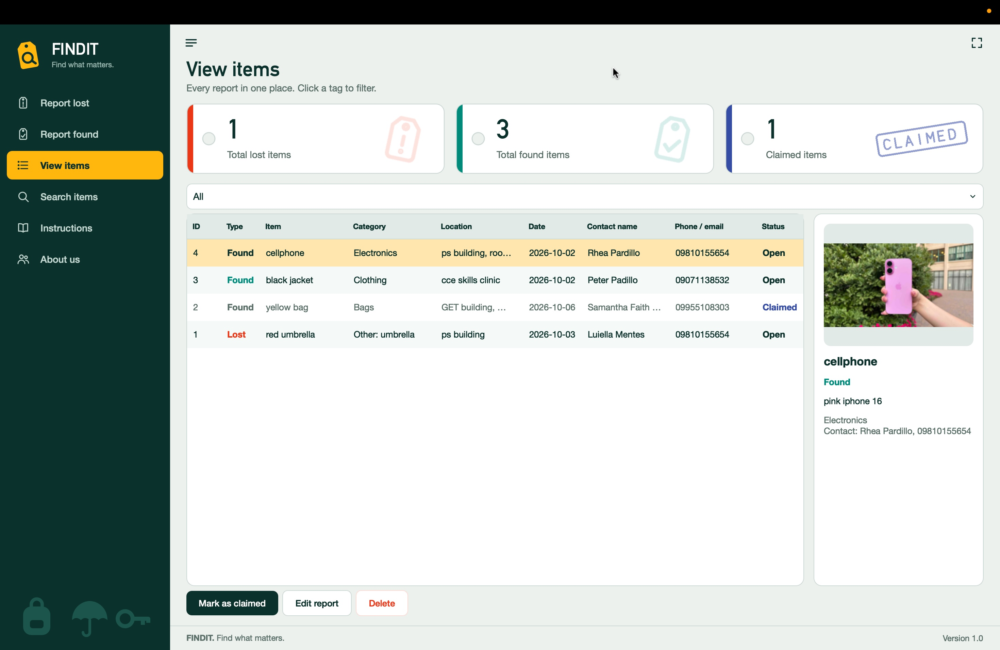
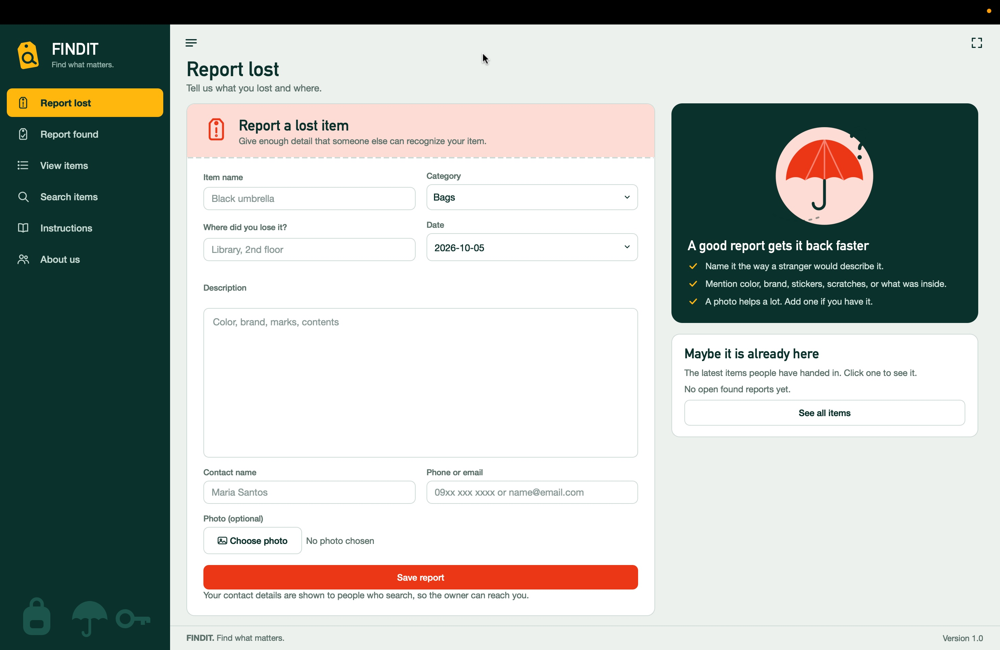
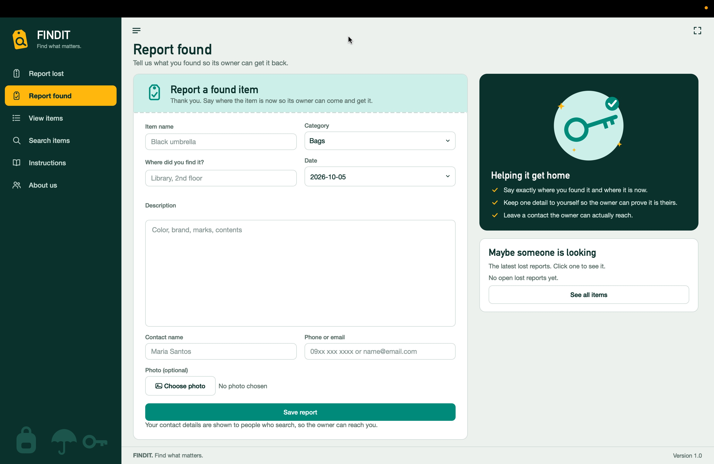
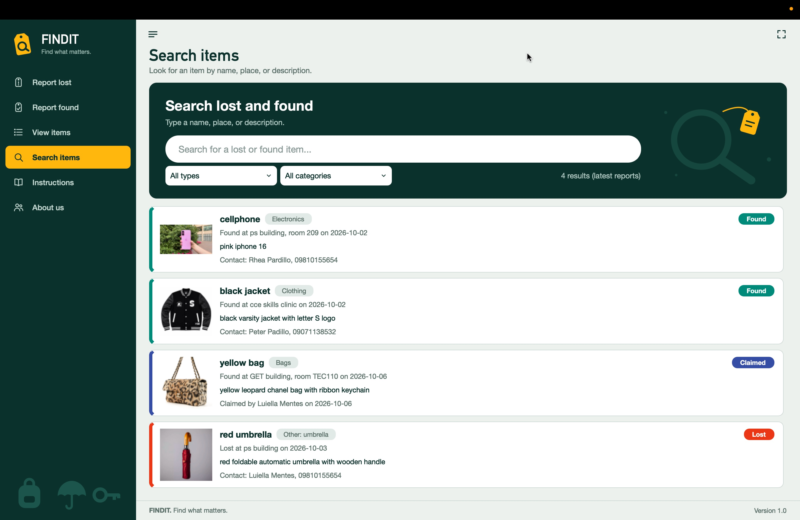
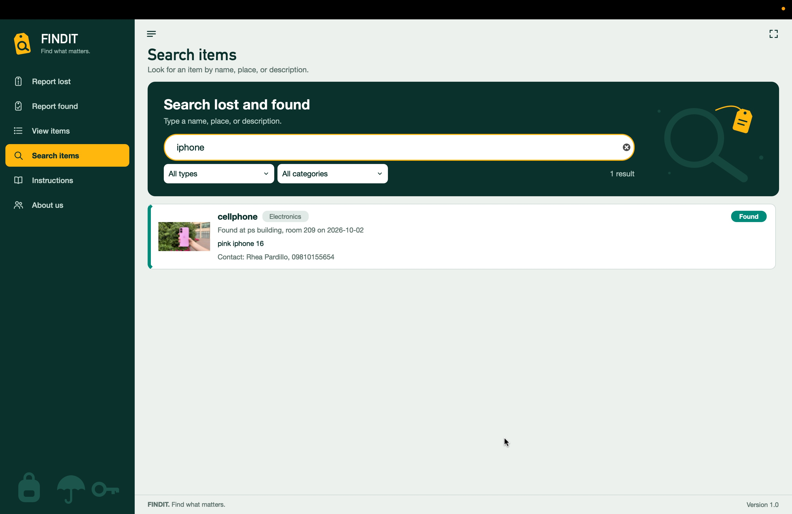
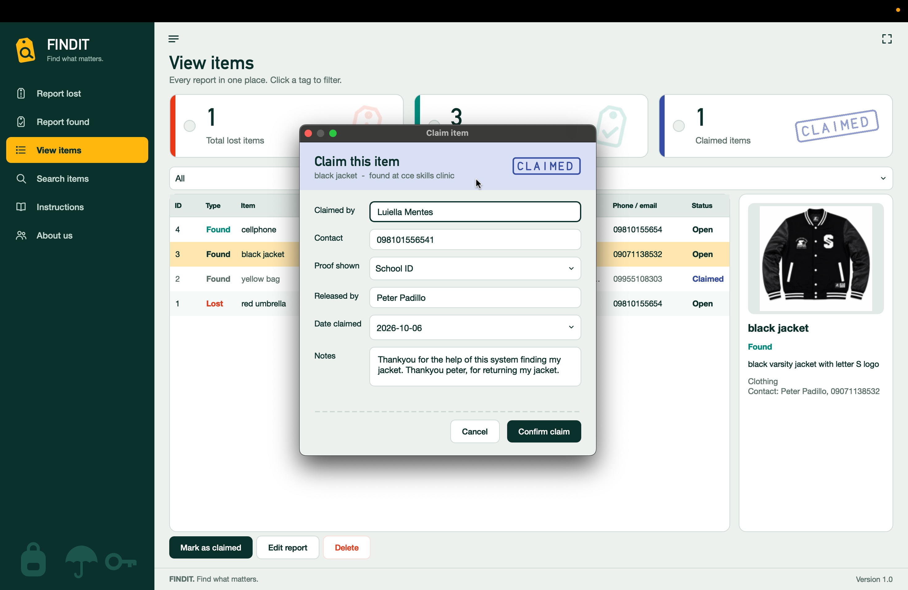

# Title

**FINDIT: Find what Matters**  
*Institutional Lost and Found Management System*

---

# Description

FINDIT: Find what Matters is a desktop application that helps institutions, campuses, and users record, track, and manage lost and found items. The user registers lost or found items (with name, category, location, contact, date, and optional image), views active logs on a central dashboard, and uses an automated search engine to match missing items with found reports. Items can be dynamically searched, filtered, updated, and marked as claimed.

**Problem addressed:** Campus and office environments often rely on unstructured messaging boards or manual paper logs to handle lost items. Many items go unclaimed or remain lost because there is no centralized, searchable database to cross-reference reported lost items with found items automatically. FINDIT gives them a simple, offline tool that organizes records clearly and suggests potential item matches.

---

# Objectives

- Let users log lost and found items with detailed metadata and categorization.
- Provide dynamic search, filtering, and automated similarity matching between lost and found entries.
- Summarize active, found, and claimed statistics so users can manage claims and item returns efficiently.
- Enforce clean data architecture using parameterized SQLite storage to guarantee data integrity and security.

---

# Features

| Feature | Description |
|---|---|
| Dashboard view | Central view displaying active statistics (Lost, Found, Claimed) and recent activity logs. |
| Report lost item | Log a missing item with title, category, location, date, contact information, and optional image. Missing required inputs are rejected with a validation message. |
| Report found item | Log a discovered item with category, date, location, contact info, and picture. Missing inputs trigger immediate feedback. |
| Automated match engine | Scans database records to cross-reference reported lost items against found items based on category overlap and string similarity scoring. |
| Dynamic search & filter | Search items in real-time by keyword or filter table entries by category and status (`LOST`, `FOUND`, `CLAIMED`). |
| Claim management | Process item returns by recording claimant details and proof of ownership to update item status to `CLAIMED`. |
| Item editing & deletion | Edit existing item details or delete outdated/duplicate records. |
| Status tracking | Clear status tags (`LOST`, `FOUND`, `CLAIMED`) color-coded across the user interface. |
| Dynamic relative timestamps | Automatically formats dates into readable relative timestamps (e.g., "2 days ago") for activity logs. |
| Centralized QSS theme system | Manages fonts, design tokens, colors, and custom QSS stylesheets consistently across all application windows. |

---

# Technologies Used

- **Programming language:** Python 3.10+
- **GUI framework:** PyQt6
- **Database:** SQLite (`sqlite3` module, included with Python)
- **Other libraries and tools:**
  - `pathlib`, `datetime`, `os`, `sys`, and `shutil` from the Python standard library
  - Git and GitHub for version control

---

# Project Structure

```
lostandfound/
├── .gitignore              # Files and directories ignored by Git
├── main.py                 # Entry point; initializes QApplication and main dashboard
├── README.md               # Project documentation
├── requirements.txt        # Package dependencies
├── asset/                  # Graphical assets and resources
│   ├── art/                # Illustrative art assets
│   └── image/              # Application icons and image assets
├── dashboard/
│   ├── __init__.py
│   ├── dashboard.py        # Central dashboard window layout and subviews
│   ├── graphics.py         # Custom canvas and graphics elements
│   └── theme.py            # Centralized QSS design system tokens and styles
├── database/
│   ├── __init__.py
│   ├── database.py         # SQLite connection context, schema definitions, and queries
│   └── data/               # Local persistent database directory (lostandfound.db)
├── features/
│   ├── __init__.py
│   ├── browse_items.py     # Filterable list and table view for item records
│   ├── change_status.py    # Dialog/action to switch item status
│   ├── claim_item.py       # Claim registration and proof logging dialog
│   ├── delete_items.py     # Deletion handling for database item entries
│   ├── edit_item.py        # Interface for editing logged item details
│   ├── found_items.py      # Found item logging dialog form
│   ├── lost_items.py       # Lost item logging dialog form
│   ├── match_dialog.py     # Match suggestions view dialog
│   ├── search_items.py     # Custom search and filter panel layout
│   ├── side_panel.py       # Sidebar panel navigation widget
│   └── upload_items.py     # Image/file upload utility widget
└── logic/
    ├── __init__.py
    ├── labels.py           # Helper rules for dynamic UI label strings
    ├── matching.py         # Item similarity matching algorithms
    ├── timeago.py          # Relative date and timestamp calculation helpers
    └── validation.py       # Input validation logic and error handling
```

**Purpose of each folder:**

- `features/` & `dashboard/` holds everything the user sees and interacts with. It handles UI layouts, navigation, dialogs, and Qt signals/slots.
- `logic/` holds the rules of the system (validation, similarity matching, timestamp calculations). It contains no GUI code and operates independently.
- `database/` holds all SQL execution and persistent storage. No other package writes direct SQL.
- `asset/` holds graphic designs, icons, and visual UI components.
- `main.py` starts the application, loads stylesheets, and launches the central dashboard event loop.

---

# Screenshots

| Screenshot | Description |
|---|---|
|  | **Main Dashboard:** Active statistics (Lost, Found, Claimed), quick navigation, and recent activity feed. |
|  | **Report Lost Item Form:** Form interface with input validation for logging missing items. |
|  | **Report Found Item Form:** Form interface for recording discovered items with location and image attachment options. |
|  | **Browse & Search View:** Table list view with dynamic search bar, category filters, and status tags. |
|  | **Automated Match Engine:** Dialog highlighting candidate matches based on category and description similarity. |
|  | **Process Claim Form:** Dialog recording claimant proof of ownership and updating item status to `CLAIMED`. |

---

# Installation and Setup

**Requirements:** Python 3.10 or newer, and Git.

1. Clone the repository:
   ```bash
   git clone https://github.com/your-username/lostandfound.git
   cd lostandfound
   ```
2. (Optional) Create a virtual environment:
   - On macOS/Linux:
     ```bash
     python3 -m venv venv
     source venv/bin/activate
     ```
   - On Windows:
     ```cmd
     python -m venv venv
     venv\Scripts\activate
     ```
3. Install required dependencies:
   ```bash
   pip install -r requirements.txt
   ```
4. Run the application from the project root:
   ```bash
   python main.py
   ```

The database file (`database/data/lostandfound.db`) and necessary tables are initialized automatically on the first run.

---

# How to Use the System

1. Launch the application with `python main.py`. The dashboard opens displaying summary counts and recent item logs.
2. Click **Report Lost Item** to open the lost item form.
3. Select a **category**, fill in **item name**, **description**, **location**, **date**, and **contact information**, then click **Save**.
4. To log a found item, click **Report Found Item** and enter the details.
5. Go to **Browse Items** to view all recorded entries in a filterable table.
6. Use the **Search & Filter** bar to query items by title keyword or switch views between `LOST`, `FOUND`, and `CLAIMED`.
7. Click **Find Matches** on an item entry to view the automated similarity suggestion list generated by the matching engine.
8. When an owner claims an item, select the item, click **Mark as Claimed**, enter the claimant details and proof of ownership, and confirm to update its status to `CLAIMED`.

---

# OOP Implementation

## Important classes and objects

| Class | File | Role |
|---|---|---|
| `Database` | `database/database.py` | Encapsulates SQLite connection management and query execution |
| `DashboardWindow` | `dashboard/dashboard.py` | Main window container for statistics and navigation |
| `Theme` | `dashboard/theme.py` | Holds global design tokens, color hex values, and QSS compiler methods |
| `BrowseItemsWindow` | `features/browse_items.py` | Widget view presenting filterable table views of item entries |
| `LostItemsDialog` | `features/lost_items.py` | Dialog window for inputting lost item entries |
| `FoundItemsDialog` | `features/found_items.py` | Dialog window for inputting found item entries |
| `MatchDialog` | `features/match_dialog.py` | Dialog window showcasing potential match candidates |
| `ClaimItemDialog` | `features/claim_item.py` | Dialog processing item claim verification and status updates |
| `EditItemDialog` | `features/edit_item.py` | Dialog interface for updating existing item records |
| `SidePanel` | `features/side_panel.py` | Side navigation panel widget for switching active views |

## Where the OOP concepts are applied

- **Encapsulation:**
  - `Database` encapsulates database operations behind explicit methods like `add_item()` or `fetch_all()`, hiding direct connection management from UI files.
  - Core logic modules in `logic/` encapsulate domain rules inside clean functions, keeping raw logic separated from PyQt6 widgets.
- **Inheritance:**
  - `BrowseItemsWindow` inherits from `QWidget`.
  - `LostItemsDialog`, `FoundItemsDialog`, `MatchDialog`, `EditItemDialog`, and `ClaimItemDialog` inherit from `QDialog`.
  - Custom UI container cards inherit from `QFrame`.
  - Classes call `super().__init__()` during setup to construct parent Qt widget behaviors.
- **Polymorphism:**
  - Distinct dialog classes inherit from `QDialog` and share standard window management methods (`exec()`, `accept()`, `reject()`).
  - Custom event handlers and layout drawing methods override base PyQt6 widget behaviors.
- **Composition and abstraction:**
  - The `DashboardWindow` is composed of reusable sub-widgets, custom buttons, layout managers, and design system tokens. High-level GUI views interact with data strictly through `Database` class methods.

---

# Database

## Structure

SQLite database file: `database/data/lostandfound.db`.

**Table `items`**

| Column | Type | Notes |
|---|---|---|
| id | INTEGER | Primary key, auto-increment |
| type | TEXT | Not null (`LOST` or `FOUND`) |
| name | TEXT | Not null |
| category | TEXT | Not null |
| location | TEXT | Not null |
| date | TEXT | Not null |
| description | TEXT | Optional |
| contact | TEXT | Not null |
| image | TEXT | Optional image file path |
| status | TEXT | Default `'Open'` (`Open` or `Claimed`) |
| contact_name | TEXT | Optional contact person |
| other_category | TEXT | Optional custom category entry |

**Table `claims`**

| Column | Type | Notes |
|---|---|---|
| id | INTEGER | Primary key, auto-increment |
| item_id | INTEGER | Foreign key linking to `items(id)` |
| claimed_by | TEXT | Not null |
| contact | TEXT | Not null |
| proof | TEXT | Optional description of proof |
| released_by | TEXT | Optional staff member name |
| date | TEXT | Timestamp of claim |
| notes | TEXT | Optional notes |

**Table `categories`**

| Column | Type | Notes |
|---|---|---|
| id | INTEGER | Primary key, auto-increment |
| name | TEXT | Not null, unique |

## Database operations and where the app uses them

| Operation | Function | Used by | Description |
|---|---|---|---|
| Create | `add_item()` | Lost/Found Dialogs | Inserts a new lost or found item record |
| Create | `add_claim()` | Claim Item Dialog | Logs a claim entry and marks the item status as `Claimed` |
| Read | `get_all_items()` | Browse & Dashboard views | Fetches item records from the database |
| Read | `get_item_by_id()` | Match & Claim dialogs | Fetches specific item details by ID |
| Read | `get_matching_items()` | Match Engine | Queries candidate items in the same category with opposing status |
| Update | `update_status()` | Change status / Claim | Updates item status (`LOST`, `FOUND`, `CLAIMED`) |
| Update | `update_item()` | Edit Item Dialog | Updates recorded details for an existing item |
| Delete | `delete_item()` | Delete items logic | Deletes an item entry from the database |

All database operations utilize parameterized queries (`?` placeholders) to prevent SQL injection vulnerabilities.

---

# Testing

| # | Test | Input / Condition | Expected Result | Actual Result |
|---|---|---|---|---|
| 1 | Empty required fields | Empty item title or contact | Validation error thrown; submission rejected | Validation error thrown; submission rejected |
| 2 | Date format parsing | Standard date string (`YYYY-MM-DD`) | Parsed successfully without error | Parsed successfully without error |
| 3 | Invalid date string | Invalid date string format | Error flagged by validator | Error flagged by validator |
| 4 | Exact match scoring | Matching category and identical descriptions | High similarity score generated | High similarity score generated |
| 5 | Opposing status filter | Compare `LOST` item against `FOUND` items | Only `FOUND` items returned as match candidates | Only `FOUND` items returned as match candidates |
| 6 | Different category filter | Items in different categories | Ignored by match engine | Ignored by match engine |
| 7 | Relative timestamp | Timestamp from 2 days prior | Returns `"2 days ago"` | Returns `"2 days ago"` |
| 8 | Parameterized insert | Item details with special characters | Escaped safely via parameters; record inserted | Escaped safely via parameters; record inserted |

---

# Known Issues / Limitations

- **Local path image handling:** Image attachment references rely on local system file paths rather than centralized remote cloud storage.
- **Desktop SQLite boundary:** Designed for single-instance desktop deployments; concurrent multi-user network access is not supported by SQLite.
- **Manual string matching threshold:** Matching scoring relies on token overlap rules rather than complex machine-learning NLP embeddings.

---

# Author

- **Name:** *Luiella Jane Mentes*
- **Section:** *CS26L(3581)*